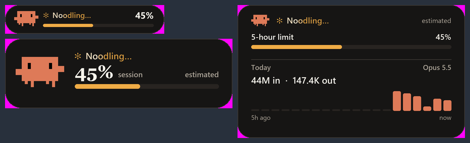
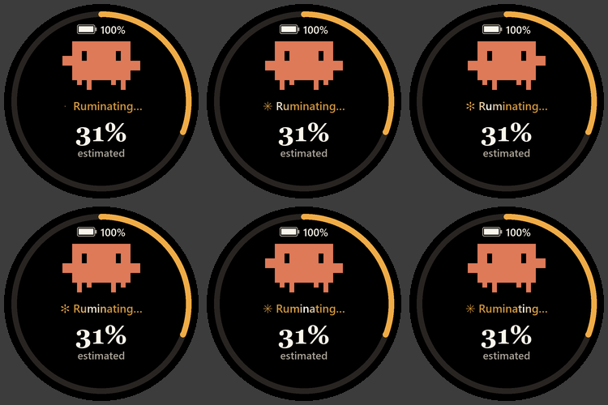
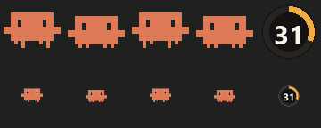

# Claude Usage Meter

A tiny, animated Claude Code usage meter for Windows. It shows your 5-hour and weekly limits at a glance on your **desktop**, in your **taskbar tray**, and on the built-in **screen of compatible keyboards**, with a pixel crab and Claude Code's "thinking" spinner.

- **Works for everyone:** the desktop widget and tray icon need no special hardware.
- **macOS:** an experimental, untested menu bar version is on the [`macos-experimental`](https://github.com/darylcamzworkwithme-cmd/claude-usage-meter/tree/macos-experimental) branch (see its `docs/MACOS.md`). Mac testers wanted.
- **Keyboard screens:** RK N99 supported today, with more keyboards and brands on the roadmap (see [Keyboard compatibility](#keyboard-compatibility)).

> **Unofficial.** Not affiliated with, endorsed by, or supported by Anthropic or Royal Kludge. "Claude" and the Claude pixel mascot are Anthropic's; "Royal Kludge"/"RK" are Royal Kludge's. Used here for identification only.
>
> ⚠️ **Use at your own risk.** The keyboard feature writes to your keyboard screen's memory using a reverse-engineered protocol. The authors aren't liable for any damage to your keyboard, computer, data or accounts. Read the full **[Disclaimer](DISCLAIMER.md)** before using it.

| Desktop widget (docked, floating, expanded card) | Keyboard knob screen | Tray icon |
|---|---|---|
|  |  |  |

## Features

- **Desktop widget**: a slim pill docked on the taskbar or floating anywhere. Click it to open a `/usage`-style card with every plan limit, reset times, today's tokens, and a 5-hour activity graph. Works with multiple monitors.
- **Tray icon**: a walking pixel crab that alternates with your usage %. Hover for details; right-click for the menu.
- **Keyboard screen**: a meter on your keyboard's built-in display (animated mascot, thinking spinner, usage ring, keyboard battery). Currently the RK N99's round knob screen; see compatibility below.
- **Alerts**: Windows notifications at 75% / 90% and when your session resets.
- **Hotkeys**: `Ctrl+Alt+W` shows or hides the widget; `Ctrl+Alt+C` shows the meter on the keyboard.

## Keyboard compatibility

The desktop widget and tray icon work on any Windows PC. Keyboard-screen support is per model:

| Status | Keyboards | Notes |
|---|---|---|
| ✅ **Supported (tested)** | **Royal Kludge RK N99** | Round 240×240 knob screen, over the USB cable |
| 🟡 **Possible, help wanted** | Royal Kludge **S98**, **S85**, **N80**, **M87** | These have screens, but RK uses a different protocol on them; RK's own web driver can upload to them, so they're portable |
| 🟢 **Recommended next brand** | **SteelSeries** Apex Pro / Apex 7 (OLED) | Official **GameSense SDK**: no reverse engineering, no risk to the keyboard |
| 🟡 **Possible via community tools** | Ajazz / Epomaker **AK820 Pro**, Ajazz **AKS075**, Yunzii **AL80**, Zuoya **GMK87**, XVX **S-K80** | Independent open-source screen tools exist and could be wrapped as modules |
| 🛠️ **DIY** | QMK/KMK/ESP32 boards with screens or knobs (SmartKnob, HelloWord, …) | You control the firmware, so add a usage screen directly |

Only the RK N99 has been tested; everything else is untested, so use it at your own risk. Details, IDs, screen sizes and sources: **[docs/COMPATIBILITY.md](docs/COMPATIBILITY.md)**. To check what you have, run `python tools/detect.py` (read-only). Want to add your keyboard? See [docs/PROMPTS.md](docs/PROMPTS.md) (prompt 4) and open a pull request.

## Build or customize it with Claude Code

The whole project was made with Claude Code. [docs/PROMPTS.md](docs/PROMPTS.md) has copy-paste prompts to install it, restyle it, wire up real usage numbers, or adapt it to your own keyboard's screen safely.

## Requirements

- Windows 10/11, Python 3.10+
- Claude Code installed and signed in
- Optional: a [compatible keyboard](#keyboard-compatibility) for the keyboard-screen feature (currently the RK N99: USB cable for the screen, Bluetooth for battery level)

## Install

```powershell
git clone https://github.com/darylcamzworkwithme-cmd/claude-usage-meter.git
cd claude-usage-meter
pip install -r requirements.txt
pythonw app.py
```

To start it at login, press `Win+R`, type `shell:startup`, and add a shortcut to:
`"<path-to>\pythonw.exe" "<path-to>\claude-usage-meter\app.py"`

## Where the numbers come from

Pick one in `config.py`. The first available source wins.

1. **Usage API** (`USE_USAGE_API = True`, off by default): the same numbers as Claude Code's `/usage`, including 5-hour, weekly, and per-model limits with exact reset times. It uses Claude Code's existing login; read [SECURITY.md](SECURITY.md) before enabling it. The endpoint is undocumented and may change.
2. **Claude Code status line**: add `statusline.py` as your status line (instructions inside the file). Claude Code passes it `rate_limits` on supported plans.
3. **Local estimate**: from your Claude Code logs. It's rough, it can't see resets or other devices, and it's labelled "estimated".

Today's token counts and the activity graph always come from your local Claude Code logs.

## Keyboard screens: read this first (RK N99)

- The screen is a separate USB device. It can only be updated **over the USB cable**; Bluetooth and the 2.4 GHz dongle can't carry screen data. On wireless, the screen keeps showing the last meter.
- Uploading replaces the screen's **custom GIF slot**. Back up your own GIF first; you can restore the factory animation with RK's official software.
- Uploads write to the screen's flash memory, so the app uploads at most every 30 minutes, and only when something visible changes.
- **Use at your own risk.** The protocol was reverse-engineered for interoperability; see [docs/PROTOCOL.md](docs/PROTOCOL.md). Other RK models aren't tested.

## Files

| File | What it does |
|---|---|
| `app.py` | The app: tray, widget, keyboard sync, alerts |
| `widget.py` / `tray.py` / `meter.py` | Desktop widget, tray icon, and keyboard updater (each can also run alone) |
| `render.py` | Draws the round keyboard meter |
| `rk_screen.py` | RK N99 screen protocol: ID check, upload, show (new keyboards go in modules next to it) |
| `tools/detect.py` | Read-only: lists connected RK keyboards and whether they're supported |
| `usage.py` / `usage_api.py` / `statusline.py` | Usage data sources |
| `battery.py` | Keyboard battery over Bluetooth LE (read-only) |
| `tools/hidlog.js` | Optional WebHID logger for studying other RK keyboards |

## License and disclaimer

[MIT](LICENSE). Provided as is, without warranty; see [DISCLAIMER.md](DISCLAIMER.md).
